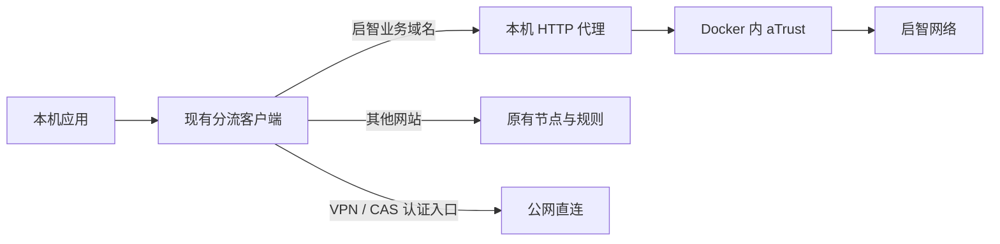

# Qizhi-Atrust-skill · 启智 VPN

让 Codex 检查、部署并启动 Docker 隔离的启智 aTrust VPN。启智业务流量进入容器，其他网站继续使用现有 Clash Verge 或其他客户端的分流规则。

## 在新电脑上首次使用

在新电脑的本地 Codex 中操作，让 agent 能使用本机终端和浏览器。以下两段指令分两次发送：先安装技能，再开始部署。

### 1. 从 GitHub 安装技能

```text
使用 $skill-installer 安装以下 GitHub 技能：

仓库：zhangchenxi1224/Qizhi-Atrust-skill
技能目录：qizhi-vpn
版本：v1.0.1

请确认本机实际使用的技能目录，并检查安装成功。
```

仓库是公开的，下载不需要提供本项目的 GitHub 凭据。安装完成后，在下一条消息中调用技能；如果没有出现，可重启 Codex 后再试。安装机制见 [官方技能说明](https://learn.chatgpt.com/docs/build-skills#install-curated-skills-for-local-use)。

仓库名是 `Qizhi-Atrust-skill`，其中的技能目录和调用名仍是 `qizhi-vpn`。

### 2. 让 agent 完成首次配置和登录

```text
使用 $qizhi-vpn 帮我完成这台电脑的首次配置和登录。

请直接执行：
1. 检查系统架构、现有代理客户端、Docker 和 aTrust 部署。
2. 缺少依赖时，从官方来源安装并配置，部署 Docker 隔离的 aTrust。
3. 启智业务流量走容器；其他网站保持本机现有代理的规则和节点。
4. 多个代理客户端用途不明确时询问我。
5. 登录时向我索取启智账号密码，我授权仅在这台电脑加密保存。
6. 完成正常登录；需要验证码、系统权限或必要确认时再让我参与。
7. 验证启智实际走 aTrust，至少两个外网站点仍走原有路线，并保存配置供以后启动使用。

请完成部署和验证，不要只提供操作建议。
```

首次配置需要你自己的启智账号及有效访问权限，账号密码通过 agent 提供的输入方式或本机交互终端输入，不要写入本仓库文件。需要用户完成的系统授权、协议确认、短信验证或扫码会按实际流程处理。

### 3. 以后日常启动

```text
使用 $qizhi-vpn 帮我启动启智 VPN。
```

技能会复用已有部署和有效会话，必要时重新登录，并检查启智和外网两条路径；会话有效时无需重复输入密码。

## 手动下载安装

也可以从 [Releases](https://github.com/zhangchenxi1224/Qizhi-Atrust-skill/releases) 下载 `qizhi-vpn-skill.zip`，或克隆本仓库，取出其中的 `qizhi-vpn` 文件夹。

让 agent 先确认目标电脑实际扫描的用户级技能目录，再将文件夹放入其中。当前官方文档列出 `~/.agents/skills`；本项目最初验证环境的安装器使用 `$CODEX_HOME/skills`，默认 `~/.codex/skills`。以目标机版本和实际配置为准，避免重复安装两份。

最终目录层级应为 `skills/qizhi-vpn/SKILL.md`，避免多嵌套一层。已有同名技能时先备份再更新；运行时状态和凭据保存在技能目录之外。

## 分流方式



默认 `sii.edu.cn` 业务流量走 aTrust；建立连接所需的 `vpn.sii.edu.cn`、`cas.sii.edu.cn` 是公网直连例外。原来使用 Rule 模式时保留原规则；原来使用 Global 模式时，按用户意图保留当前外网出口或恢复规则分流。

代理和 noVNC 只监听本机 loopback。容器代理的出站限制用于在 VPN 失效时阻止启智业务流量回落到普通网络。HTTP 代理不承载 UDP，默认拒绝启智域 UDP；其他域名、直接 IP、SSH 等需求需要按实际业务适配和验证。

## 凭据与登录

仓库和 ZIP 均不包含账号密码、验证码、订阅配置、浏览器会话、Docker 数据卷或本机部署备份。

在用户授权保存后，Windows 使用当前用户的 DPAPI，macOS 使用系统钥匙串；Linux 需要可用的 Secret Service / KWallet。凭据不会随技能包迁移，换电脑需在新电脑保存自己的凭据。

日常启动由 agent 调用脚本并操作正常登录页面，`start` 脚本本身不处理所有网页认证。短信验证、扫码或系统授权仍需用户参与。aTrust 可能因闲置自动退出，技能会检测并重新认证，不承诺永久在线。

## 支持范围与验证

- 已实测 Windows amd64：Docker 隔离、登录恢复、重复启动不重启健康容器、Clash Verge / Mihomo 分流、启智入口与三个外网站点的实际连接路径。
- macOS / Apple Silicon：包含检测、钥匙串和适配流程，尚未在 Mac 实机验证；需核对容器镜像架构和客户端能力。
- 其他代理客户端：由 agent 按其当前官方语法适配，不能原样套用 Mihomo 配置，也不保证任意 VPN 客户端均支持分流。

本仓库不分发 aTrust 安装包或镜像。Docker 模板依赖经过检查、固定 digest 且架构匹配的外部镜像；当前模板基于 Debian bookworm，换底座前需要检查兼容性。aTrust 客户端及服务的使用遵循其自身条款。

## 文件与维护

- [技能入口](qizhi-vpn/SKILL.md)：触发场景和日常流程。
- [安装部署](qizhi-vpn/references/setup.md)、[客户端分流](qizhi-vpn/references/clients.md)、[登录](qizhi-vpn/references/login.md)、[排障](qizhi-vpn/references/troubleshooting.md)。
- `qizhi-vpn/scripts/`：检测、登记、启动、验证、加密凭据和模板生成工具。
- `qizhi-vpn/assets/`：Docker 构建模板与 Mihomo overlay。

可执行无网络业务变更的回归检查（Python 3、Node；安装 Docker CLI 时同时验证 Compose 语法）：

```text
python qizhi-vpn/scripts/self_test.py
```

该检查覆盖规则保留、重复应用、Global 模式适配、名称冲突、无路由证据时不得误报通过，以及 Windows DPAPI 往返；不会启动、停止或修改实际 VPN。跨平台功能应在目标机验证。

参考项目：[docker-easyconnect / aTrust](https://github.com/docker-easyconnect/docker-easyconnect)、[Clash Verge Rev](https://github.com/clash-verge-rev/clash-verge-rev)、[Mihomo](https://github.com/MetaCubeX/mihomo)。本技能是独立的自动化配置工具，与上述项目及启智服务提供方无隶属关系。
