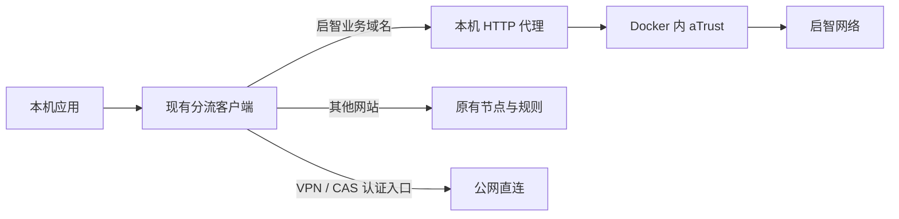

# 启智 VPN Skill

让 Codex 检查、部署并启动 Docker 隔离的启智 aTrust VPN。启智业务流量进入容器，其他网站继续使用现有 Clash Verge 或其他客户端的分流规则。

## 两种使用方式

安装技能后，在 agent 对话中输入：

```text
使用 $qizhi-vpn 检查并部署启智 VPN 分流。
```

技能会检查已有代理客户端、Docker、容器和登录状态，按需安装配置；多个客户端用途不明确时会询问。日常使用输入：

```text
使用 $qizhi-vpn 帮我启动启智 VPN。
```

技能会复用现有部署与有效会话，必要时完成正常登录，最后检查启智和外网两条路径。首次使用需要你自己的启智账号及有效访问权限。

## 安装

从 [Releases](https://github.com/zhangchenxi1224/qizhi-vpn-skill/releases) 下载 `qizhi-vpn-skill.zip`，解压后将 `qizhi-vpn` 文件夹放入 Codex 技能目录：

- Windows：`%USERPROFILE%\.codex\skills\qizhi-vpn`
- macOS / Linux：`~/.codex/skills/qizhi-vpn`
- 设置了 `CODEX_HOME` 时使用其下的 `skills` 目录。

确保最终路径是 `skills/qizhi-vpn/SKILL.md`，避免多嵌套一层目录。也可以克隆本仓库后复制 `qizhi-vpn` 文件夹。已有同名技能时先备份再更新；运行时状态和凭据保存在技能目录之外。

## 分流方式



默认 `sii.edu.cn` 业务流量走 aTrust；建立连接所需的 `vpn.sii.edu.cn`、`cas.sii.edu.cn` 是公网直连例外。原来使用 Rule 模式时保留原规则；原来使用 Global 模式时，按用户意图保留当前外网出口或恢复规则分流。

代理和 noVNC 只监听本机 loopback。容器代理的出站限制用于在 VPN 失效时阻止启智业务流量回落到普通网络。HTTP 代理不承载 UDP，默认拒绝启智域 UDP；其他域名、直接 IP、SSH 等需求需要按实际业务适配和验证。

## 凭据与登录

仓库和 ZIP 均不包含账号密码、验证码、订阅配置、浏览器会话、Docker 数据卷或本机部署备份。

在用户授权保存后，Windows 使用当前用户的 DPAPI，macOS 使用系统钥匙串；Linux 需要可用的 Secret Service / KWallet。凭据不会随技能包迁移，换电脑需在新电脑保存自己的凭据。

日常启动由 agent 调用脚本并操作正常登录页面，`start` 脚本本身不处理所有网页认证。短信验证、扫码或系统授权仍需用户参与。aTrust 可能因闲置自动退出，技能会检测并重新认证，不承诺永久在线。

## 支持范围与验证

- 已实测 Windows amd64：Docker 隔离、登录恢复、重复启动不重启健康容器、Clash Verge / Mihomo 分流、启智入口与三个外网站点的实际连接路径。
- macOS / Apple Silicon：包含检测、钥匙串和适配流程，尚未在 Mac 实机验证；需核对容器镜像架构和客户端能力。
- 其他代理客户端：由 agent 按其当前官方语法适配，不能原样套用 Mihomo 配置，也不保证任意 VPN 客户端均支持分流。

本仓库不分发 aTrust 安装包或镜像。Docker 模板依赖经过检查、固定 digest 且架构匹配的外部镜像；当前模板基于 Debian bookworm，换底座前需要检查兼容性。aTrust 客户端及服务的使用遵循其自身条款。

## 文件与维护

- [技能入口](qizhi-vpn/SKILL.md)：触发场景和日常流程。
- [安装部署](qizhi-vpn/references/setup.md)、[客户端分流](qizhi-vpn/references/clients.md)、[登录](qizhi-vpn/references/login.md)、[排障](qizhi-vpn/references/troubleshooting.md)。
- `qizhi-vpn/scripts/`：检测、登记、启动、验证、加密凭据和模板生成工具。
- `qizhi-vpn/assets/`：Docker 构建模板与 Mihomo overlay。

可执行无网络业务变更的回归检查（Python 3、Node；安装 Docker CLI 时同时验证 Compose 语法）：

```text
python qizhi-vpn/scripts/self_test.py
```

该检查覆盖规则保留、重复应用、Global 模式适配、名称冲突、无路由证据时不得误报通过，以及 Windows DPAPI 往返；不会启动、停止或修改实际 VPN。跨平台功能应在目标机验证。

参考项目：[docker-easyconnect / aTrust](https://github.com/docker-easyconnect/docker-easyconnect)、[Clash Verge Rev](https://github.com/clash-verge-rev/clash-verge-rev)、[Mihomo](https://github.com/MetaCubeX/mihomo)。本技能是独立的自动化配置工具，与上述项目及启智服务提供方无隶属关系。
